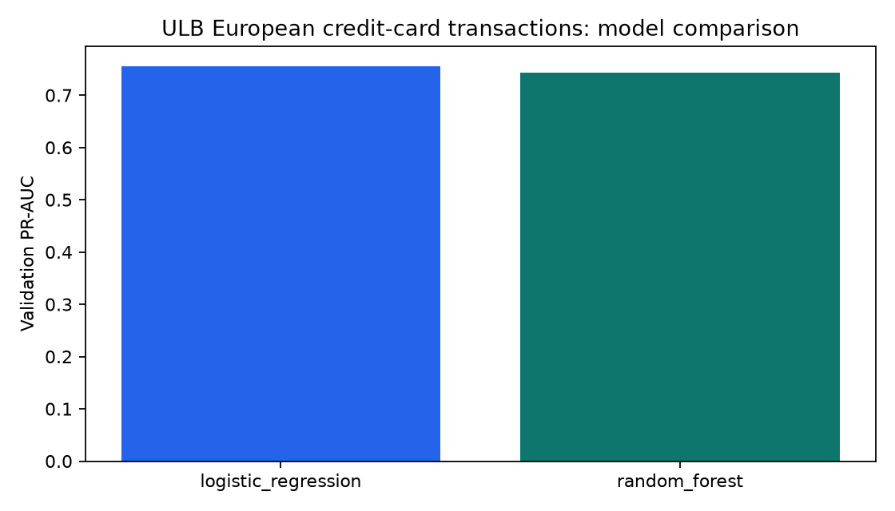
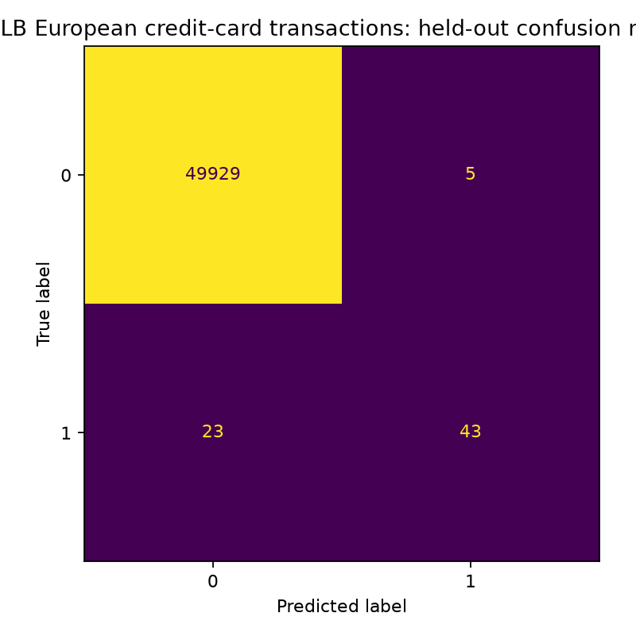

# ULB Real Credit-Card Fraud ML

Standalone PyCharm project for the real, anonymized ULB/Worldline European card-transaction dataset. It compares class-weighted logistic regression and random forest models under a time-ordered evaluation.

## Dataset

- [Original Kaggle distribution](https://www.kaggle.com/datasets/mlg-ulb/creditcardfraud)
- 284,807 real transactions, including 492 confirmed fraud cases
- `V1`–`V28` are anonymized PCA components; `Time` and `Amount` retain their published meaning

The anonymization prevents business-level interpretation of the PCA components. This project must not invent meanings for them.

## PyCharm setup and run

Open the whole folder and create a Python 3.11 virtual environment:

```bash
python -m pip install --upgrade pip
python -m pip install -e ".[dev]"
python scripts/download_data.py
python preprocess_data/run.py
python training_model/train.py
python evaluation/evaluate.py
python -m fraudbench.inference examples/sample_transaction.json
python -m uvicorn fraudbench.api:app --host 127.0.0.1 --port 8060
```

The download script uses TensorFlow's public mirror and saves `data/raw/creditcard.csv`. Raw data remains ignored by Git.

## Folder guide

| Folder | Contents |
|---|---|
| `dataset` | Source, limitations and expected filename |
| `preprocess_data` | Time-ordered split entrypoint |
| `preprocessed_df` | Generated model table |
| `training_model` | Training entrypoint |
| `checkpoint` | Selected `.joblib` model |
| `evaluation` | Evaluation entrypoint |
| `outputs` | Metrics, predictions and charts |
| `utils` | Team helper scripts |

## Evaluation design

- Rows are ordered by `Time`, then divided 60%/20%/20%.
- Sampling occurs after splitting and preserves the target ratio.
- Scalers and imputers are fitted only inside the model pipeline.
- Validation PR-AUC selects the model; test data is evaluated once.
- Accuracy is reported but is not the main metric because only 0.172% of rows are fraud.

## Citation

Dal Pozzolo, A. et al., “Calibrating Probability with Undersampling for Unbalanced Classification,” IEEE SSCI, 2015.

## Current trained result

Logistic regression was selected. On the later 50,000-row real-transaction sample it achieved PR-AUC **0.7432**, ROC-AUC **0.9830**, precision **0.8958**, recall **0.6515**, and F1 **0.7544**. See [`outputs/metrics.json`](outputs/metrics.json) and [`outputs/model_comparison.csv`](outputs/model_comparison.csv).




